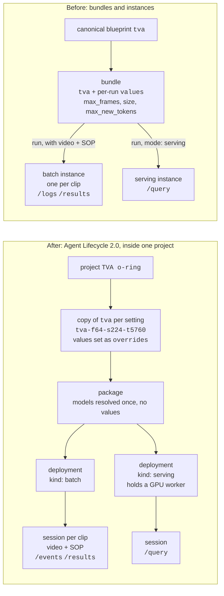

# Migrating to Agent Lifecycle 2.0

How this example moved from bundles and instances to **projects, packages,
deployments and sessions**, and what to watch for if you move your own scripts.

`/api/agents/bundles` and `/api/agents/instances` are being removed: some deployments of
the platform already answer 404 for them, and the rest keep them only until their next
platform release. A deployment serves the new calls when
`GET {root}/api/agents/sessions?limit=1` answers 200, not 404.

TVA fits nothing, so its move is simpler than the fitted agents' (AD, OSM, RED): no
optimization, no promotion. The one thing a bundle did that nothing downstream of a
blueprint can do any more is carry `values`. A **copy of `tva` with `overrides`** takes
its place.

## Before and after

- **Project:** where everything lives. A copy of a blueprint lands in the project you
  name; its package, deployments and sessions take their project from it.
- **Copy:** `tva` with this setting's values set on it, under a key that names them.
  One per setting, reused by every later run at that setting, from any script.
- **Package:** one blueprint, target `platform`, with its models resolved when it is
  built. It has **no values**.
- **Deployment:** the package placed to run. `batch` is ready at once; `serving`
  places and loads the agent on a GPU worker and holds it until it is stopped.
- **Session:** a run on a deployment. On `batch`, one run over one clip and its SOP.
  On `serving`, a client's handle on the loaded agent, answering `/query` once it is
  `running`.

## What moved where

| Before | After | Why it changed |
|---|---|---|
| canonical `tva`, outside any project | a copy of `tva` in your project | a deployment needs a project, and everything takes its project from the blueprint it starts from |
| `values` on a bundle | `overrides.values` on the copy, one copy per setting | a package, a deployment and a batch session take no values |
| bundle | package | its models are resolved once, at build time |
| instance (batch), one per clip | batch deployment + a session per clip | the deployment is set up once per setting; each clip is a session |
| instance (serving) | serving deployment + a session | the deployment holds the loaded agent; the session is a client of it |
| `/logs`, to spot a stuck or empty run | session `status`, `error`, `/events`; count the verdicts | a session has no `/logs` |
| `GET /instances` to find runs after a disconnect | `state/lifecycle.json` | each session is recorded the moment it is opened |

## Old calls, new calls

All paths are under `{root}/api/agents` unless shown otherwise.

| Before | After |
|---|---|
| — | `POST {root}/api/projects` `{name, description}` |
| `POST /bundles` `{blueprint: "tva", values}` | `POST /blueprints/tva/copy` `{project_id, blueprint_key, overrides: {values}}`, then `POST /packages` `{blueprint_ids: [blp_…], target: {kind: "platform"}, name}`; poll until `ready` |
| `POST /bundles/{id}/run` `{connectors}` | `POST /deployments` `{package_id, kind: "batch"}`, then `POST /sessions` `{deployment_id, connectors: {source: [mp4, txt]}}` |
| `POST /bundles/{id}/run` `{mode: "serving"}` | `POST /deployments` `{package_id, kind: "serving"}`; poll until `ready`; `POST /sessions` `{deployment_id}`; poll until `running` |
| `GET /instances/{id}` | `GET /sessions/{id}` (`status`, `error`) |
| `GET /instances/{id}/logs` | `GET /sessions/{id}/events` (newest first; there is no `/logs`) |
| `GET /instances/{id}/results` | `GET /sessions/{id}/results` |
| `POST /instances/{id}/query` | `POST /sessions/{id}/query` (same body, same `response`) |
| `POST /instances/{id}/cancel`, `DELETE /instances/{id}` | `POST /sessions/{id}/cancel`, `DELETE /sessions/{id}` |
| `DELETE /bundles/{id}` | `POST /deployments/{id}/stop`, `DELETE /deployments/{id}`, then `DELETE /packages/{id}` |

Statuses: package `building → ready | failed`; deployment `deploying → ready → stopping
→ stopped | failed`; session `pending → running → completed | failed | cancelled` (and
`paused`).

## What changed in practice

1. **Values go on a copy, one copy per setting.** A bundle took `max_frames`, `size`
   and `max_new_tokens` per run. A package, a deployment and a batch session take
   none; a batch session given `values` is refused with a `422`. A copy takes
   `overrides.values`, and since `tva` fits nothing, any of its values may be set
   there. `tva_project.py` keys each copy by its values (`tva-f64-s224-t5760`),
   finds it in the project or makes it, and reuses its package and deployments, so a
   sweep at one setting builds one agent and any later run at that setting builds
   none. A different `--max-frames`, `--size` or `--max-new-tokens` is a different
   copy.

2. **A plain copy runs at the blueprint's defaults, and they are not this example's.**
   The `tva` blueprint currently defaults to `max_new_tokens` 8192: the budget this
   example measured looping inside `<think>` and returning `results: []` on a hard
   clip, where 5760 returned correct verdicts. The scripts default to 5760 and always
   set it on the copy.

3. **A copy checks keys; it does not check wiring.** A bundle stored any key and
   ignored the ones the blueprint did not use. A copy refuses a key the blueprint
   does not declare with a `400`, but still accepts a declared value that no node
   references. The preflight (`tva_api.inert_values`) still reads the document for
   that.

4. **The SOP is still a run-time input.** It moved from the bundle run's connectors
   to the session's, unchanged: `connectors.source` holds the video (`mp4`) and the
   SOP (`txt`), routed by `format`. One deployment serves every SOP.

5. **A session has no `/logs`.** A bundle run's `/logs` carried model-load timings,
   the parser's warnings and errors; it was the only place an empty run showed why.
   A session has lifecycle `/events` (opened, dispatched, failed with a reason) and a
   terminal `status` with `error`. An empty run (the token budget spent inside
   `<think>`) still ends `completed`, so the scripts count the verdicts
   (`tva_api.empty_output`). Whether the parser's warning or matching nothing caused
   an empty result can no longer be told apart from outside.

6. **Serving sessions take values, but only session fields.** `POST /sessions` on a
   `serving` deployment accepts `values` for a node's session fields: for TVA, the
   fusion model's `max_new_tokens`. `max_frames` and `size` are not session fields,
   so `sweep_serve.py` uses the same per-setting copy as batch, and serving and batch
   run the same setting.

7. **A serving deployment holds the GPU, not the session.** `sweep_serve.py` cancels
   and deletes its session and stops and deletes the serving deployment on exit,
   Ctrl-C included; `--keep` leaves both up for `--session`. A serving session closes
   after 30 idle minutes by default.

8. **A session's result `ref` is a root path.** `/sessions/{id}/results` returns
   `ref: "/api/files/<fil_…>/content"`, which already includes `/api`; appending it to
   an `…/api` endpoint gives `/api/api/…` and a 404 (`tva_api.fetch_results`).

9. **Record ids before waiting on them.** A sweep is hours long and the client can die
   while the runs go on. Every session is written to `state/lifecycle.json` the
   moment it is opened, and every package and deployment before anything waits on
   it, so `sweep.py --collect` and `cleanup.py` find them. With bundles,
   `GET /instances` listed the org's runs instead.

10. **Cleanup goes session, deployment, package.** Each holds the next. `cleanup.py`
    starts from each recorded package and lists its deployments and their sessions,
    so ones a script never recorded are found too. The project and its copies stay;
    delete the copies and then the project by hand if you want them gone.

## This repo, file by file

| File | Change |
|---|---|
| `tva_api.py` | `copy_blueprint`, `create_package` and `package_ready`, `deploy` and `deployment_ready`, `open_session`, `wait_running`, `poll_session`, `empty_output`, `fetch_results` from sessions, `cancel_session`, `end_session`, `end_deployment`; the bundle and instance helpers removed |
| `tva_project.py` | new: the project `TVA o-ring`, a copy of `tva` per setting, its package and deployments, and every session, in `state/lifecycle.json` |
| `run_tva_example.py` | one batch session on the setting's deployment; `--dry-run` prints the copy, package, deployment and session bodies; `--name` removed |
| `sweep.py` | one deployment for the sweep, a session per clip; `--collect` and `--cancel-all` walk the recorded sessions; `--bundle` becomes `--setting` |
| `iterate_sop.py` | a session per SOP variant on the setting's deployment |
| `sweep_serve.py` | a serving deployment and one session, both deleted on exit; `--agent` becomes `--session`; `--size` and `--blueprint` added |
| `cleanup.py` | new: sessions, deployments, packages, found from each recorded package |

## Results

The results in the README were measured with bundles. On this branch, on a deployment
that serves the new calls (2026-11-05 and -06), both reruns gave the same answers:

| Run | Lifecycle 2.0 | Bundles |
|---|---|---|
| 12-clip batch (`sweep.py --all --submit-all --out-dir eval_lc2`) | 28/36 steps (step 1 7/12, step 2 12/12, step 3 9/12); every clip `completed` with 3 verdicts; `results` equal to `eval_prod/` for 12 of 12 clips | 28/36, `eval_prod/` |
| Stage 6 serving (`sweep_serve.py --all --out-dir eval_serving_lc2`) | 12 outputs byte-identical to `eval_serving/`: 28/36 steps (step 1 6/12, step 2 12/12, step 3 10/12); the serving deployment took 693 s to start, then 2.8–8.0 s per clip (3.3 s median); 739 s in all | `eval_serving/` |

## Moving your own scripts

1. Create a project, or reuse yours, and copy the blueprint you start from into it,
   with the values your runs need as `overrides.values`. Make one copy per setting.
2. Package the copy (poll until `ready`), deploy the package as `batch` or
   `serving`, and replace each run with a session on that deployment.
3. Move each run's inputs to the session's `connectors.source`, unchanged.
4. Poll the session's `status`, read `/events` and `/results`, and resolve result
   refs against the root, not against `…/api`. Check outputs for empty results
   yourself: there is no `/logs`.
5. Clean up sessions, then deployments, then packages; stop serving deployments
   when you're done, since each holds a worker.
