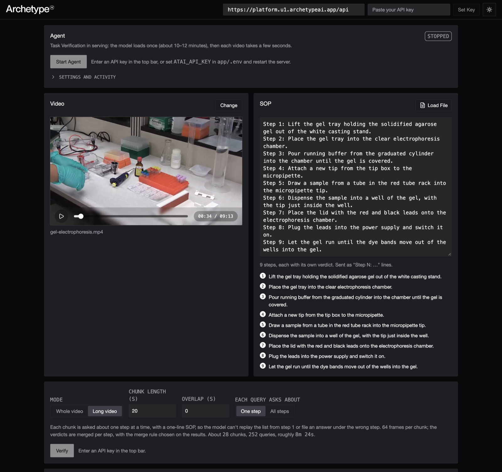
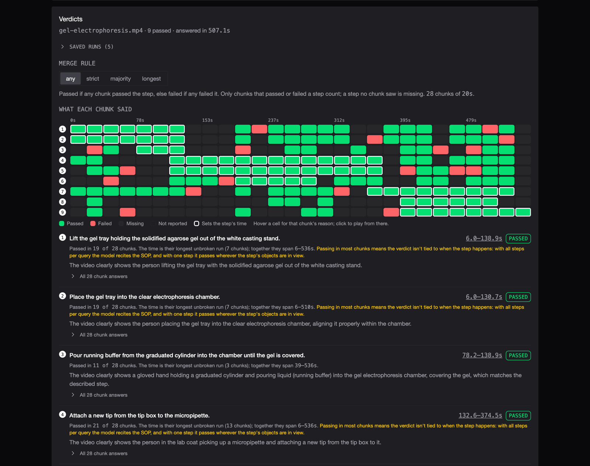
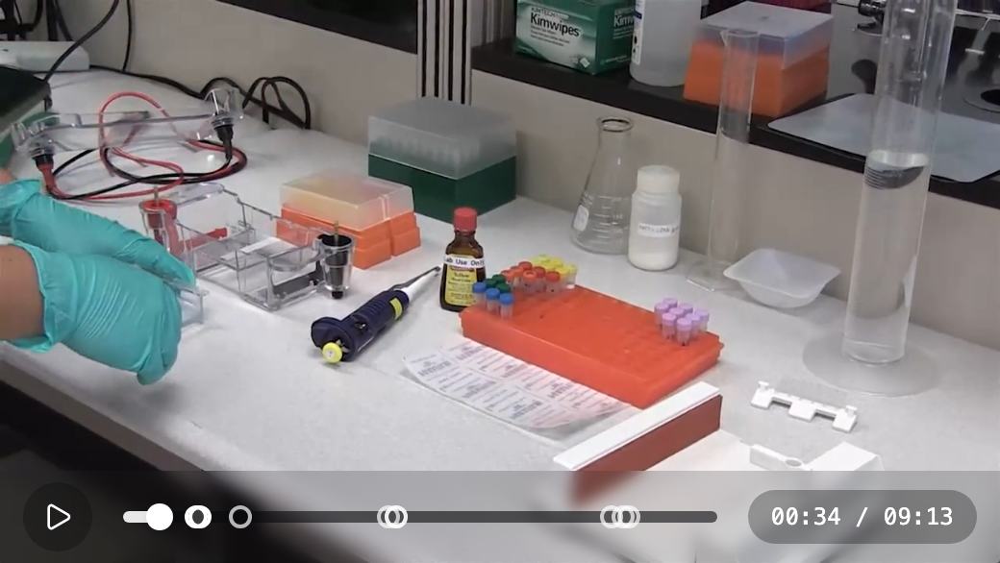
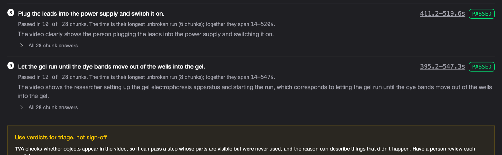

# Task Verification App

A local web UI for TVA in serving: load any video, give it an SOP, get a verdict per step.
Built with the [Archetype AI Design System](https://github.com/archetypeai/agent-skills/tree/main/skills/atai-design-system)
(SvelteKit + Tailwind v4); the API is `server/server.py`, stdlib Python over the repo's `tva_api`.

```sh
npm install
npm run build
python3 server/server.py        # http://127.0.0.1:8765; needs ffmpeg
```

While working on the UI, run both: `python3 server/server.py` and `npm run dev`
(Vite proxies `/api` to the Python server).



1. **Endpoint and API key**: either from a `.env` file or typed in the top bar.
   - **`.env`**: at startup the server reads `ATAI_API_KEY` and `ATAI_API_ENDPOINT` from
     `app/.env` if it has a key, else from the repo's `.env` (the CLI scripts' file). The
     two are read as a pair from the same file, because a key only works on the
     deployment that issued it; no endpoint means `https://platform.u1.archetypeai.app/api`.
     The activity log says whether the key worked, and the top bar shows which file it
     came from.
   - **In the app**: type a key and/or endpoint and press **Set key**. That overrides
     the `.env` values until the server restarts. The pair is checked against the
     platform first, and nothing changes if the check fails. Keys typed in the app are
     held in memory only, never written to disk.

   (The design system's `CLAUDE.md` says never to read the key from `.env`; this app does
   so on purpose, so people can choose either way.)
2. **Start agent**: deploys TVA as `serving`, downloads the model weights and loads them:
   10–20 minutes, on every start (see [below](#starting-the-agent-takes-1020-minutes-mostly-downloading-model-weights)). It holds a
   GPU until you stop it or quit the server (`--keep` leaves it up; setting the key again
   on the next start reattaches).
3. **Video + SOP**: drop a video (re-encoded to fit the 2 MiB query cap). Type the SOP or
   load a `.txt`/`.md` file. A Markdown list becomes one step per item.
4. **Verify**: one `/query`, a few seconds. Verdicts appear as markers on the video's seek
   track. Click a time range to play that step.

### Starting the agent takes 10–20 minutes, mostly downloading model weights

The model weights aren't kept between starts: every **Start agent** places a fresh serving
deployment on a GPU, which downloads and loads the models from scratch. Expect:

| Phase | What the page shows | Time |
|---|---|---|
| Project, `tva` copy and package | "Preparing the project, blueprint copy and package" | about 1 s, but a few minutes the first time for a key (the package build) |
| Deploying: a GPU, then downloading and loading the weights | "Deploying: the platform places the deployment on a GPU, then downloads and loads the model weights"; the activity log shows the deployment's status once a minute | about 10–12 min, with no progress reported (11 min on 2026-11-18). In this repo's batch runs, downloading newton-fusion alone took ~5 min and loading it another 2–6 |
| Opening the session | "Session open; waiting for it to report running" | seconds: the weights are already loaded |
| Ready | badge **running**, Verify enabled | |

Measured in this repo: 710 s from requesting a serving deployment to its first answer
(`sweep_serve.py`, 2026-11-12), and batch runs pay the same ~7–12 minute download and
load on every clip. After that, each query takes seconds (about 5 s per 20 s chunk).
Even at **running**, the first query can still time out (HTTP 504) while the model finishes
warming up. The app retries a few times; if it still fails, verify again.

So start the agent once and keep it for a batch of videos. Stopping it frees the GPU, but
the next start pays the whole download again. The platform also stops a session after 30
idle minutes. The server notices, stops the deployment, and the page asks you to start again.

### Long videos

**Whole video** sends one query: the model sees 64 frames spread over the whole video, and
the re-encoded video must fit the 2 MiB request, about a minute or two. **Long video** cuts
it into chunks (the chunk length and overlap are settings) using `sweep_serve.cut_chunks`.
Each chunk is checked against the whole SOP with 64 frames per chunk. The answers are then
merged per step by `merge_chunks.merge`, and you can switch the rule on the results without
querying again:

| Rule | A step is |
|---|---|
| `any` (default) | passed if any chunk passed it, else failed if any failed it |
| `strict` | failed if any chunk failed it, else passed if any passed it |
| `majority` | the more common of passed and failed; a tie is failed |
| `longest` | the verdict from the chunk with the longest interval |

**Each query asks about** *One step* (the default: one query per chunk per step, each with
a one-line SOP) or *All steps* (one query per chunk, against the whole SOP). With all
steps, the model's `step` is just the row's position in its answer. On the gel example
it treated each chunk as the whole procedure, passing steps 1…k in order, filing answers
under the wrong step, and never reaching steps 8 and 9. One step per query got all 9,
each in the chunks where it happens, at the cost of steps × chunks queries (~2 s each:
252 queries, about 9 minutes, against 28 queries, about 2 minutes). Both still pass steps in
chunks where they don't happen; see
[`examples/gel-electrophoresis`](../examples/gel-electrophoresis/README.md).

The results show a **steps × chunks grid** of what every chunk said; hover a cell for its
reason, click it to play from there. A merged verdict's time range is its longest unbroken
run of agreeing chunks (outlined in the grid), not the span of all of them. Each step says
how many chunks agreed, with a warning when it passes in most of them.



The verdicts also mark the video's seek track; click a marker to play that step:



Steps 8 and 9 of the gel example, which all-steps runs always reported missing, pass with
one step per query. Each step folds its 28 chunk answers under **All 28 chunk answers**:



Every result is saved in `app/runs/`; **Saved runs** reopens one (also as `?run=<name>`).

Only chunks that passed or failed a step count. A step that every chunk reported as
missing stays missing. Each step shows its per-chunk tally (e.g. `MISSING×5 PASSED×1`).
A chunk that got no answer is left out and named. The repo found chunking exploratory: on
its 30 s clips it didn't fix the o-ring blind spot.

The app keeps its own project (`TVA App`) and state in `app/state/`, apart from the CLI scripts.
The brand fonts are not installed: the UI renders in system fallbacks until the licensed
PP Neue Montreal files are placed in `static/fonts/` (don't commit them).

`CLAUDE.md` and `ds-manifest.json` are the design system's own agent config, installed by
`ds create`.
